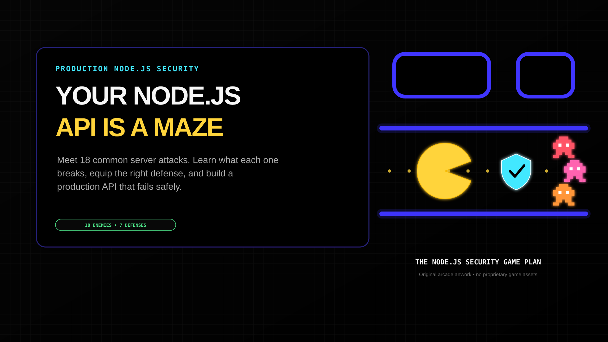

# API Security Maze

A dependency-free, playable introduction to 18 common Node.js API security attacks and the production defenses that stop them.

**Live site:** https://yuvis003.github.io/api-security-maze/



## What is inside

- One playable black-arcade maze
- 18 attack explainers
- Seven defensive gates
- A ten-control production loadout
- A five-question checkpoint
- Responsive and reduced-motion layouts
- No analytics, API calls, trackers, or external runtime dependencies

The simulation is defensive education. It sends no attack traffic and is not a scanner, penetration test, certification, or deployment guarantee.

## Run locally

The committed `site/` folder can be served directly:

```bash
python3 -m http.server 8000 --directory site
```

Then open http://localhost:8000.

## Build and validate

Requires Node.js 18 or later and no npm dependencies:

```bash
npm test
```

`npm test` rebuilds `site/` from `src/arcade.html` and then checks JavaScript syntax, content coverage, CSP, local links, metadata, icon dimensions, maze geometry guards, deployment size, and absence of automatic network APIs.

## Configure companion articles

Edit `site.config.json`:

```json
{
  "rateLimitingArticleUrl": "https://…",
  "databaseScalingArticleUrl": "https://…"
}
```

Leave either value empty to render a clearly disabled placeholder instead of a broken link. Rebuild with `npm test`.

## Deployment

`.github/workflows/pages.yml` builds, validates, and publishes `site/` whenever `main` is pushed. In repository settings, the Pages source must be **GitHub Actions**.

The expected project URL is:

https://yuvis003.github.io/api-security-maze/

## Favicon and social preview

- `src/favicon.svg` — original scalable security-maze mark
- `src/favicon-32.png` — browser fallback
- `src/apple-touch-icon.png` — 180×180 touch icon
- `src/icon-192.png` and `src/icon-512.png` — installable-site icons
- `src/og-image.png` — 1920×1080 social preview

## Security and privacy

The deployed Content Security Policy blocks runtime network connections. The game stores no credentials and collects no visitor information. See [`SECURITY.md`](SECURITY.md) for reporting.

## Sources

The educational content is grounded in [Node.js Security Best Practices](https://nodejs.org/en/learn/getting-started/security-best-practices), [OWASP Top 10](https://top10.owasp.org/2025/), [OWASP API Security Top 10](https://api-security.owasp.org/editions/2023/en/0x11-t10/), [CISA DDoS guidance](https://www.cisa.gov/resources-tools/resources/understanding-and-responding-distributed-denial-service-attacks), and [NIST SSDF](https://csrc.nist.gov/pubs/sp/800/218/final).

The arcade artwork is original and uses no proprietary game assets, maps, logos, audio, or fonts. “Pac-Man” is used only as an explanatory metaphor in the related article. This project is not affiliated with or endorsed by Bandai Namco.

Content was rephrased for compliance with licensing restrictions.
